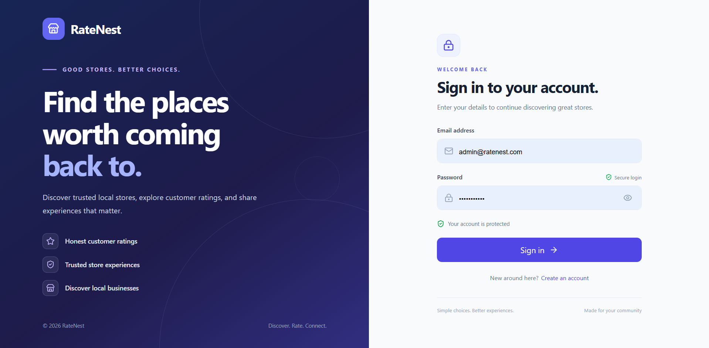
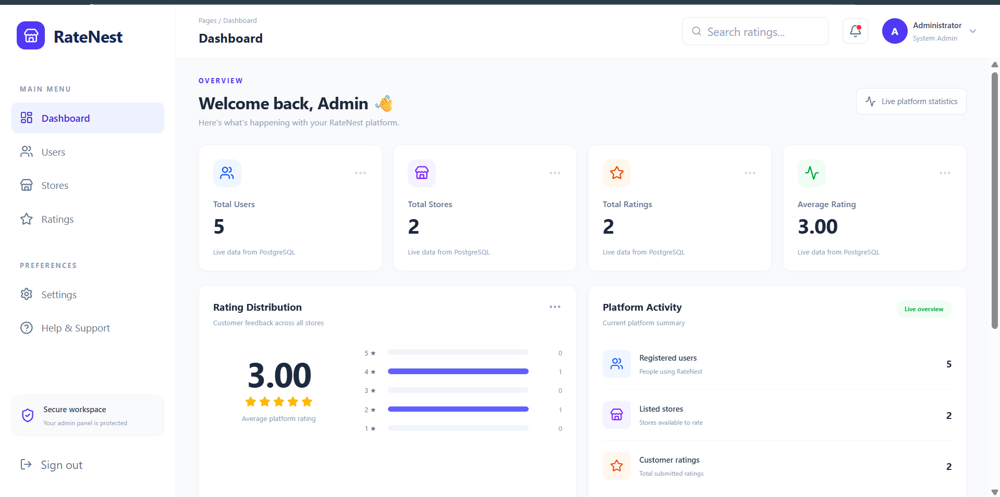
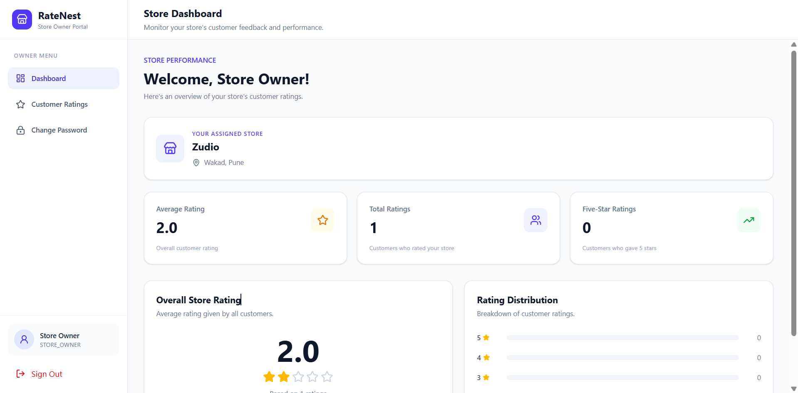
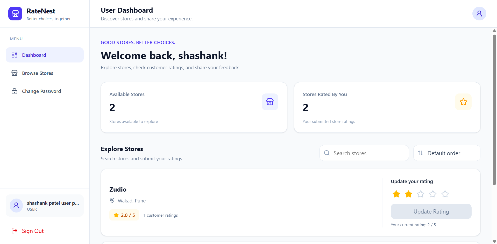
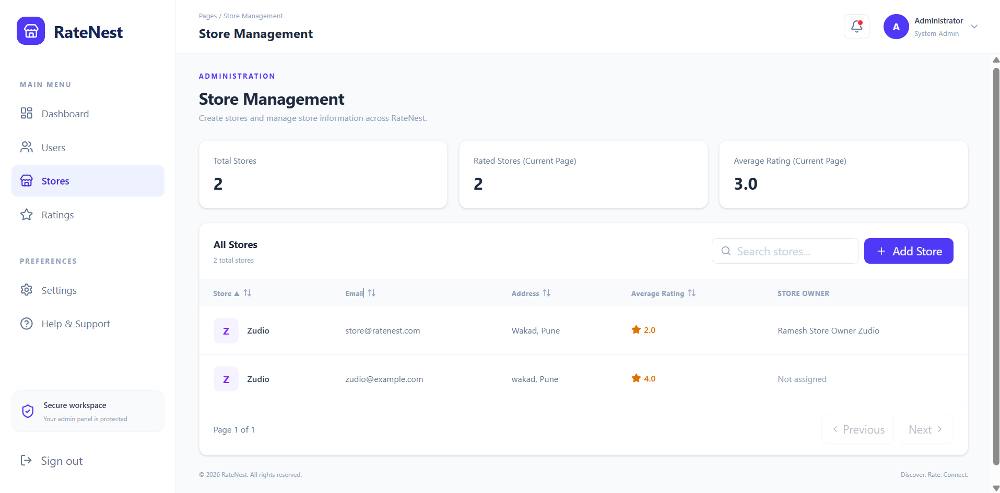

# ⭐ RateNest – Store Rating Management System

RateNest is a full-stack web application designed to simplify store rating management through a secure, role-based platform. It allows customers to discover stores, submit ratings, and manage their reviews, while administrators and store owners can monitor store performance through dedicated dashboards.

The application provides three distinct user roles: **System Administrator, Normal User, and Store Owner**, each with specific permissions and functionality.

---

## 📸 Screenshots

Screenshots of the RateNest application are maintained in the `images/` directory.

### 1. Login Page



*Secure login interface for accessing role-specific dashboards.*

### 2. Admin Dashboard



*Administrator dashboard displaying platform statistics and management options.*

### 3. Store Management



*Manage registered stores and assign Store Owners.*

### 4. User Dashboard



*Browse stores, view ratings, and submit or update reviews.*

### 5. Store Owner Dashboard



*Monitor store performance, average ratings, and customer feedback.*

---

## 📑 Table of Contents

- [Project Overview](#-ratenest--store-rating-management-system)
- [Screenshots](#-screenshots)
- [Features](#-features)
  - [System Administrator](#-system-administrator)
  - [Normal User](#-normal-user)
  - [Store Owner](#-store-owner)
- [Technology Stack](#-technology-stack)
- [Project Structure](#-project-structure)
- [Installation and Setup](#-installation-and-setup)
- [Application Validation Rules](#-application-validation-rules)
- [Security](#-security)
- [Contributing](#-contributing)
- [License](#-license)
- [Author](#-author)

---

## 🚀 Features

RateNest provides role-specific functionality to ensure efficient store rating management.

### 👨‍💼 System Administrator

- Secure administrator login.
- View dashboard statistics, including total users, stores, and ratings.
- Create and manage user accounts.
- Add and manage stores.
- Create Store Owner accounts and assign them to existing stores.
- View and filter registered users, stores, and ratings.
- Access detailed user and store information.
- Manage the overall platform through an administrator dashboard.

### 👤 Normal User

- Register and log in securely.
- Browse all available stores.
- Search and explore stores.
- View store details and average ratings.
- Submit ratings between 1 and 5 stars.
- Update previously submitted ratings.
- Maintain one rating per store.
- Change account password.

### 🏪 Store Owner

- Secure login to the assigned Store Owner account.
- Access the dashboard for the assigned store.
- View the store's average rating.
- Monitor the total number of ratings received.
- View rating distribution.
- See users who have rated their store.
- Change account password.

---

## 🛠️ Technology Stack

### Frontend

| Technology | Purpose |
|---|---|
| React.js | Building interactive user interfaces |
| Tailwind CSS | Responsive and modern styling |
| React Router | Client-side navigation |
| Lucide React | Icons and visual elements |

### Backend

| Technology | Purpose |
|---|---|
| Node.js | JavaScript runtime environment |
| Express.js | Backend framework and API development |
| REST APIs | Communication between frontend and backend |
| JSON Web Tokens (JWT) | Authentication and session management |
| bcrypt | Secure password hashing |

### Database

| Technology | Purpose |
|---|---|
| PostgreSQL | Relational database management |
| SQL | Database queries and data management |

### Development Tools

- Git and GitHub – Version control and source code management.
- npm – Dependency management.
- VS Code – Development environment.
- Postman – API testing.

---

## 📂 Project Structure

```text
RateNest/
│
├── backend/
│   ├── database/
│   │   └── schema.sql
│   │
│   ├── src/
│   │   ├── config/
│   │   ├── controllers/
│   │   ├── middleware/
│   │   ├── models/
│   │   ├── routes/
│   │   ├── validators/
│   │   └── server.js
│   │
│   └── package.json
│
├── frontend/
│   ├── src/
│   │   ├── components/
│   │   ├── pages/
│   │   ├── services/
│   │   ├── App.jsx
│   │   └── index.css
│   │
│   └── package.json
│
├── images/
│   ├── login.png
│   ├── admin-dashboard.png
│   ├── store-management.png
│   ├── user-dashboard.png
│   └── store-owner-dashboard.png
│
└── README.md
```

---

## ⚙️ Installation and Setup

Follow these steps to download, configure, and run RateNest locally.

### Prerequisites

Make sure the following tools are installed:

- [Node.js](https://nodejs.org/) and npm
- [PostgreSQL](https://www.postgresql.org/)
- [Git](https://git-scm.com/)
- [Visual Studio Code](https://code.visualstudio.com/) (recommended)

### 1. Clone the Repository

```bash
git clone <your-repository-url>
cd RateNest
```

### 2. Set Up PostgreSQL Database

Create a PostgreSQL database named `ratenest_db`:

```bash
psql -U postgres -c "CREATE DATABASE ratenest_db;"
```

Import the database schema:

```bash
psql -U postgres -d ratenest_db -f backend/database/schema.sql
```

This creates the required database tables, user roles, and the `token_version` column used for session validation.

### 3. Configure Backend Environment Variables

Navigate to the backend directory:

```bash
cd backend
```

Create your environment file.

**Windows:**

```powershell
copy .env.example .env
```

**macOS/Linux:**

```bash
cp .env.example .env
```

Open `backend/.env` and configure the required environment variables according to your backend configuration.

| Variable | Description |
|---|---|
| `DB_PASSWORD` | PostgreSQL database password |
| `JWT_SECRET` | Secret key used for JWT authentication |
| `ADMIN_NAME` | Initial administrator's name |
| `ADMIN_EMAIL` | Initial administrator's email |
| `ADMIN_PASSWORD` | Initial administrator's password |
| `ADMIN_ADDRESS` | Initial administrator's address |

Also configure the database connection details, server port, and frontend URL as required by the backend.

**Important:** Never upload your actual `.env` file or expose database credentials and secret keys on GitHub.

### 4. Install Backend Dependencies

From the `backend` directory:

```bash
npm install
```

### 5. Create the First Administrator Account

Run:

```bash
npm run create-admin
```

Use the configured administrator email and password to log in.

The administrator can create stores first, then create Store Owner accounts and assign them to the respective stores.

### 6. Start the Backend Server

```bash
npm run dev
```

The backend server will run at:

```text
http://localhost:5000
```

### 7. Install Frontend Dependencies

Open a new terminal and navigate to the frontend directory:

```bash
cd frontend
```

Install the required packages:

```bash
npm install
```

### 8. Start the Frontend Application

```bash
npm run dev
```

The frontend application will normally be available at:

```text
http://localhost:5173
```

Open the URL in your browser to access RateNest.

---

## 📋 Application Validation Rules

RateNest implements validation rules to maintain consistent and reliable data.

| Field | Validation |
|---|---|
| Name | Minimum 20 and maximum 60 characters |
| Address | Maximum 400 characters |
| Email | Must follow a valid email format |
| Password | 8–16 characters, at least one uppercase letter and one special character |
| Store Rating | Must be between 1 and 5 |
| User Rating | One rating per user per store; existing ratings can be updated |

---

## 🔐 Security

Security is an important part of the RateNest application.

- **Password Hashing:** Passwords are securely hashed using bcrypt before being stored.
- **JWT Authentication:** JSON Web Tokens are used to authenticate users and protect private routes.
- **Role-Based Authorization:** Access to dashboards and operations is restricted according to user roles.
- **SQL Injection Protection:** Parameterized SQL queries help prevent SQL injection attacks.
- **Session Invalidation:** Password changes invalidate previously issued tokens using token version validation.
- **Environment Variables:** Sensitive configuration values and database credentials are maintained outside the source code.

---

## 🤝 Contributing

Contributions, suggestions, and improvements are welcome.

To contribute:

1. Fork the repository.
2. Create a new feature branch:

   ```bash
   git checkout -b feature/your-feature-name
   ```

3. Make your changes.
4. Test your changes to ensure everything works correctly.
5. Commit your changes:

   ```bash
   git commit -m "Add: your feature description"
   ```

6. Push your branch:

   ```bash
   git push origin feature/your-feature-name
   ```

7. Open a Pull Request describing your changes.

Please ensure that your contributions follow the existing project structure and coding standards.

---

## 📄 License

This project was developed for educational and software development purposes.

No separate open-source license has been specified yet. If you intend to distribute RateNest under the MIT License, add a `LICENSE` file containing the official MIT License text and your copyright details.

---

## 👨‍💻 Author

**Shashank Patel**

Developed as a full-stack web development project using React.js, Node.js, Express.js, and PostgreSQL.

---

⭐ If you find this project useful, consider giving the repository a star on GitHub!